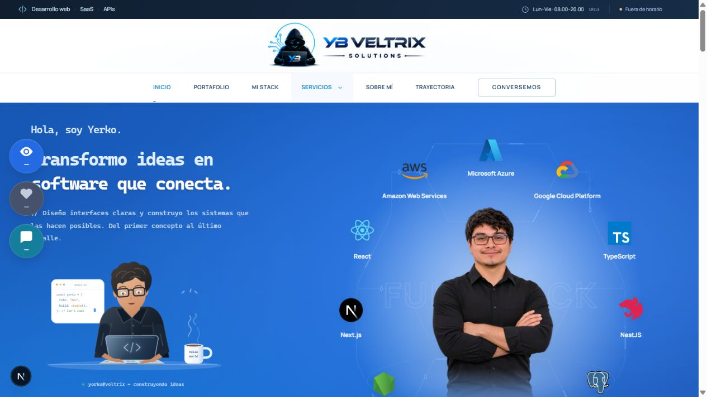

# Yerko Barrera · YB Veltrix Solutions

Portafolio profesional de **Yerko Andrés Barrera Pantoja**, Ingeniero en Computación e Informática y Licenciado en Ingeniería por la Universidad Andrés Bello. Experiencia, proyectos y tecnologías de desarrollo Full Stack, reunidos en una aplicación con **Next.js, NestJS y PostgreSQL**.

[GitHub](https://github.com/koyarxs) · [LinkedIn](https://www.linkedin.com/in/yerko-andr%C3%A9s-barrera-pantoja-a82821123/) · [Documentación del frontend](docs/frontend.md)



## Estado actual

Actualizado el **16 de noviembre de 2026**. Desarrollo local; este repositorio no acredita un despliegue de producción. El frontend editorial puede consultarse sin backend; las funciones de comunidad, visitas y administración requieren la API, PostgreSQL y su configuración.

## Novedades de esta versión

- **Navegación en tres niveles:** barra de servicios y atención, logo original centrado y menú de navegación. Incluye servicios desplegables y menú móvil.
- **Horario de atención:** lunes a viernes de 08:00 a 20:00, zona `America/Santiago`. El indicador se actualiza según el horario; no representa presencia en línea.
- **Portada animada:** fotografía personal, avatar, escritura progresiva, tecnologías y efectos visuales, con consideración de movimiento reducido.
- **Galería de proyectos:** banner propio, capturas en composiciones de monitor, tablet y celular, enlaces de GitHub, acceso al sitio de FlyMaster y reverso de tarjetas con la marca Veltrix.
- **Stack organizado:** Frontend, Backend y Bases de datos; Herramientas y Cloud; Testing, DevOps y Seguridad. Logos, descripciones breves, banners por categoría, circuitos luminosos y recorrido azul/blanco en las tarjetas.
- **Perfil y trayectoria:** formación, experiencia profesional, actividad de YB Veltrix Solutions, certificaciones y enlaces a documentos.
- **Footer renovado:** logo real, contacto, navegación, servicios y perfiles profesionales.
- **Comunidad:** comentarios, respuestas, reacciones, categorías, adjuntos de imágenes, reportes, orden y paginación.
- **Visitas y moderación:** identidad anónima firmada, contadores persistentes y panel del propietario con gestión de comentarios, reportes y participantes.

Las composiciones de dispositivos reutilizan capturas de escritorio; no son capturas móviles independientes. FraudShield conserva un esquema técnico porque no hay una captura de interfaz disponible. Los usos de AWS, Azure y Google Cloud se presentan como previstos para proyectos y laboratorios.

## Proyectos destacados

| Proyecto | Qué muestra | Tecnologías principales | Enlaces |
| --- | --- | --- | --- |
| **Pawly** | Sitio y sistema veterinario; demo en desarrollo | Next.js · NestJS · PostgreSQL | [Repositorio](https://github.com/koyarxs/Project-03-Pawly-Octubre-2026) |
| **Zenvik** | Gestión de equipos, turnos y permisos; MVP local | React · Next.js · TypeScript · Python · Django REST · PostgreSQL | [Repositorio](https://github.com/koyarxs/Project-05-Zenvik-Octubre-2026) |
| **FraudShield** | Análisis de transacciones CSV y clasificación de riesgo; proyecto de título | Next.js · NestJS · Prisma | [Repositorio](https://github.com/koyarxs/Project-01-FraudShield-Septiembre-2026) |
| **Falta Uno** | Plataforma deportiva colaborativa con Jean Paul Gómez; en desarrollo | Angular · NestJS · PostgreSQL | [Repositorio](https://github.com/koyarxs/Project-04-Sistema-Deporte-Octubre-2026) |
| **FlyMaster** | Sitio de servicios con drones y formación para pilotos | Next.js · React · NestJS · PostgreSQL | [Sitio](https://flymaster.cl) · [Repositorio privado](https://github.com/koyarxs/Project-02-FlyMaster-Octubre-2026) |

El enlace al repositorio privado de FlyMaster requiere autorización; no se publica su código en este portafolio. Los proyectos destacados se mantienen en `apps/web/lib/owner.ts`, independientes de los proyectos privados de la API.

## Arquitectura y stack del repositorio

| Capa | Tecnologías |
| --- | --- |
| Frontend | Next.js 16 · React 19 · TypeScript · Tailwind CSS 4 · CSS Modules |
| Backend | Node.js 24 · NestJS 12 · Express · validación de DTOs · Helmet · límites de solicitudes |
| Persistencia | PostgreSQL 18 · Prisma ORM 7 · adaptador PostgreSQL · migraciones SQL |
| Comunidad | BFF de Next.js · identidad anónima firmada · cookies HttpOnly · procesamiento de imágenes con sharp |
| Pruebas y herramientas | Node Test Runner · Playwright · npm workspaces · ESLint · Docker Compose |

Las dependencias exactas están fijadas en `package-lock.json`. El stack profesional mostrado en la web es más amplio que las dependencias de este repositorio: incluye Angular, Python y Django REST por Falta Uno y Zenvik, además de otras herramientas del perfil.

```text
apps/
  web/                       # App Router, diseño, BFF, panel y pruebas web
  api/                       # API REST, visitantes, comunidad y moderación
packages/
  database/src/              # Cliente Prisma compartido
  community/src/             # Contratos e identidad compartidos
prisma/
  schema.prisma              # Modelo de contenido, visitas e interacciones
  migrations/                # Historial SQL, incluidas ampliaciones de comunidad
  seed.ts                    # Catálogo inicial idempotente
scripts/                     # Configuración y verificaciones locales
docs/                        # Arquitectura, operación, fuentes y capturas
compose.yml                  # PostgreSQL local con volumen persistente
```

## Inicio rápido: frontend

Requisitos: **Node.js 24**, npm y PowerShell o una terminal compatible.

```powershell
npm ci
if (!(Test-Path .env)) { Copy-Item .env.example .env }
npm run db:generate
npm run web:dev
```

Abrir [http://127.0.0.1:3000](http://127.0.0.1:3000). Para configurar la web, copiar `apps/web/.env.example` a `apps/web/.env.local`, conservando cualquier archivo existente. Las funciones conectadas muestran estados de conexión cuando la API no está disponible.

## Base de datos y API

Requisitos adicionales: Docker Desktop con motor Linux y el puerto PostgreSQL local configurado, por defecto `55432`.

```powershell
if (!(Test-Path .env)) { Copy-Item .env.example .env }
# Elegir credenciales locales y actualizar DATABASE_URL en .env.
npm run db:up
npm run db:validate
npm run db:generate
npm run db:deploy
npm run db:seed
npm run db:verify
npm run api:dev
```

La API responde en [http://127.0.0.1:3001/api/v1](http://127.0.0.1:3001/api/v1); Swagger está en `/api/v1/docs` durante desarrollo. Los listados de contenido usan `{ data, meta }` y los detalles `{ data }`.

| Área | Rutas principales |
| --- | --- |
| Contenido | `/profile`, `/projects`, `/technologies`, `/experience`, `/education`, `/certifications`, `/security-labs` |
| Salud | `/health`, `/health/ready` |
| Interacción | `/visitors`, `/community`, comentarios, respuestas, reacciones, reportes y medios |
| Propietario | `/community-admin`, mediante credencial servidor a servidor |

Los proyectos privados de la API responden 404 en las rutas públicas. El seed conserva registros existentes y no publica automáticamente los proyectos de la base de datos.

## Comunidad y panel del propietario

```powershell
npm run community:configure
```

El asistente local prepara las variables necesarias; consultar [la guía de comunidad](docs/portfolio-community.md) antes de habilitarla. El panel está en `/admin/community`. No hay una cuenta administrativa predeterminada y el acceso permanece deshabilitado si falta su configuración.

- El navegador pasa por las rutas BFF `/api/visitors`, `/api/community` y `/api/community-admin`.
- Las claves del propietario y los secretos de firma permanecen en el servidor.
- Las imágenes se validan, procesan y sirven con comprobaciones de acceso.
- La moderación incluye aprobación, ocultación, eliminación recuperable, fijado, respuestas del propietario, reportes y bloqueo de participantes.
- Los contadores representan navegadores, no personas verificadas.

No versionar `.env`, archivos de datos, medios locales de usuarios ni credenciales. El esquema y las migraciones sí se incluyen. No eliminar volúmenes para solucionar incidencias de conexión.

## Comprobaciones

```powershell
npm run typecheck
npm run web:test
npm run test:unit
npm run api:build
npm run web:build
npm run web:test:e2e
```

Las pruebas HTTP de la web usan servicios de prueba en `3101` y `4011`; las pruebas de integración del backend requieren PostgreSQL. Para aislar las pruebas de comunidad de la base de trabajo:

```powershell
npm run community:test:isolated
```

La revisión visual reciente incluye el navbar de escritorio, el menú móvil y el desplegable de servicios. Se comprobaron los límites del horario de Chile y sus diferencias de hora de verano/invierno. Los resultados de validación de la entrega se documentan en el pull request; no se consideran aprobadas las verificaciones que no hayan podido ejecutarse.

## Documentación y recursos

- [Frontend y fuentes de contenido](docs/frontend.md)
- [Navbar y horario de atención](docs/navbar-design.md)
- [Stack y banner](docs/technology-stack.md) · [Logos y licencias](docs/stack-assets.md)
- [Trayectoria y medios profesionales](docs/career-media.md)
- [Comunidad, seguridad y moderación](docs/portfolio-community.md)
- [Operación y diagnóstico](docs/operations.md)
- [Modelo de datos](docs/database.md)
- [Backend](docs/backend.md) · [Contrato de API](docs/public-api.md)

Los logos de tecnologías conservan sus marcas y atribuciones; los recursos de Devicon incluyen su licencia. La fotografía del banner del stack acredita a Maurits Bausenhart en Unsplash. Los recursos de marca de YB Veltrix Solutions y los datos profesionales fueron proporcionados por el propietario.

---

**Yerko Barrera · YB Veltrix Solutions**
Ingeniería de Software y Desarrollo Full Stack · Valparaíso, Chile.
