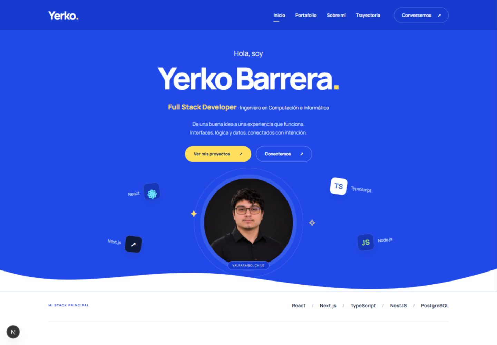

# Yerko Barrera · Portafolio Full Stack

Portafolio profesional de **Yerko Andrés Barrera Pantoja**, Ingeniero en Computación e Informática. Monorepositorio con frontend Next.js, API REST NestJS y PostgreSQL con Prisma ORM.

Estado guardado al **12 de noviembre de 2026**: base de datos, backend, API pública y primera versión del frontend implementados. Diseño azul cobalto, blanco y amarillo, foto real de LinkedIn, navegación responsive y selección de proyectos actuales. En desarrollo local; todavía no está desplegado.



## Qué incluye

- Portada personal con foto, stack, proyectos y presentación profesional.
- Navbar con menú móvil accesible y footer con enlaces profesionales.
- Proyectos con capturas, contexto, tecnologías y estado real de desarrollo.
- Rutas de perfil, trayectoria, laboratorios, contacto y casos de proyecto.
- API de consulta con validación, paginación, filtros, documentación Swagger y respuestas controladas.
- PostgreSQL en Docker, once modelos Prisma, migración inicial y seed idempotente.
- Pruebas de componentes, contratos y API; revisión visual de escritorio y móvil.

## Stack

| Capa | Tecnologías |
| --- | --- |
| Frontend | Next.js 16.4.6 · React 19.3.1 · TypeScript 5.9.3 · Tailwind CSS 4.3.5 |
| Backend | Node.js 24 · NestJS 12.4.2 · Express |
| Datos | PostgreSQL 18.3 · Prisma ORM y adaptador PostgreSQL 7.10.1 |
| Herramientas | npm workspaces · Docker Compose · ESLint · Playwright |

Las versiones de todas las dependencias están fijadas en el `package-lock.json` de la raíz.

## Proyectos de la portada

| Proyecto | Alcance y estado documentado | Enlace público |
| --- | --- | --- |
| Pawly | Sitio y sistema veterinario; demo en desarrollo | [Repositorio](https://github.com/koyarxs/Project-03-Pawly-Octubre-2026) |
| Zenvik | Gestión de equipos, turnos y permisos; MVP local | [Repositorio](https://github.com/koyarxs/Project-05-Zenvik-Octubre-2026) |
| FraudShield | Análisis de transacciones CSV y clasificación de riesgo; MVP estable | [Repositorio](https://github.com/koyarxs/Project-01-FraudShield-Septiembre-2026) |
| Falta Uno | Plataforma deportiva colaborativa, junto a Jean Paul Gómez; en desarrollo | [Repositorio](https://github.com/koyarxs/Project-04-Sistema-Deporte-Octubre-2026) |
| FlyMaster | Sitio corporativo de servicios con drones | [Sitio público](https://flymaster.cl) |

La selección editorial está en `apps/web/lib/owner.ts` y procede de fuentes públicas verificadas. Las capturas son de desarrollo; FraudShield utiliza una ilustración de portada. FlyMaster enlaza a su sitio público y no expone código privado. Cada proyecto conserva su stack real, incluido Django REST en Zenvik y Angular en Falta Uno.

Esta selección es independiente de los registros de la API: **no publica los proyectos privados de la base de datos**. Las rutas de casos siguen exigiendo contenido publicado.

## Estructura

```text
apps/
  web/                    # Next.js App Router: páginas, componentes y pruebas
  api/                    # NestJS: módulos de contenido, configuración y pruebas
packages/database/src/    # Fábrica del cliente Prisma
prisma/
  schema.prisma           # Once modelos y enumeraciones
  migrations/             # Migración inicial e historial SQL
  seed.ts                 # Catálogo inicial idempotente
scripts/                  # Verificación de integridad, persistencia y API
docs/                    # Documentación técnica y captura de la interfaz
compose.yml               # PostgreSQL local con volumen persistente
prisma.config.ts          # Configuración de Prisma 7
```

## Ejecutar el frontend

Requisitos: Node.js 24 LTS y npm. Desde la raíz, en PowerShell:

```powershell
npm ci
npm run web:dev
```

Abrir [http://127.0.0.1:3000](http://127.0.0.1:3000).

La portada, sus proyectos externos y los contactos funcionan sin la API. Las secciones conectadas al backend muestran estados vacíos o de conexión cuando no hay datos disponibles.

Configuración opcional: copiar `apps/web/.env.example` a `apps/web/.env.local`. Incluye `PORTFOLIO_API_URL`, `SITE_URL`, hosts de imágenes y listas de URLs verificadas. No incluir credenciales de PostgreSQL en el frontend.

## Iniciar la base de datos y el backend

Requisitos adicionales: Docker Desktop con motor Linux y puerto local 55432 disponible.

```powershell
if (!(Test-Path .env)) { Copy-Item .env.example .env }
# Editar .env: elegir una contraseña local propia y actualizar DATABASE_URL.
# La contraseña dentro de DATABASE_URL debe estar codificada como URL.
npm run db:up
npm run db:validate
npm run db:generate
npm run db:deploy
npm run db:seed
npm run db:verify
npm run api:dev
```

Conservar cualquier `.env` existente. Los secretos, dependencias, cliente generado y artefactos de compilación están excluidos de Git. Los datos de PostgreSQL permanecen en un volumen de Docker y **no se guardan dentro del repositorio**; el esquema, las migraciones y el seed sí quedan versionados.

La API escucha por defecto en [http://127.0.0.1:3001/api/v1](http://127.0.0.1:3001/api/v1). Swagger está disponible en `/api/v1/docs` durante desarrollo y pruebas; se desactiva en producción.

| Recurso | Rutas GET relativas a `/api/v1` |
| --- | --- |
| Perfil | `/profile` |
| Proyectos publicados | `/projects`, `/projects/:slug` |
| Tecnologías | `/technologies`, `/technologies/:slug` |
| Trayectoria | `/experience`, `/education`, `/certifications` |
| Laboratorios publicados | `/security-labs`, `/security-labs/:slug` |
| Salud del servicio | `/health`, `/health/ready` |

Los listados devuelven `{ data, meta }`; los detalles, `{ data }`. Los proyectos privados responden 404 incluso por slug. No existen rutas públicas de escritura ni formulario de contacto.

El seed añade 20 tecnologías y cinco proyectos sin publicar, sin reemplazar ediciones existentes. No inventa biografías, certificaciones, fechas ni despliegues. Por eso la API puede comenzar con proyectos públicos vacíos aunque la portada muestre la selección editorial de repositorios públicos.

## Validación y comandos útiles

```powershell
npm run typecheck
npm run lint
npm run web:test
npm run test:unit
npm run web:build
npm run web:test:e2e
```

Las pruebas HTTP del frontend requieren el build y levantan sus propios servicios de prueba en los puertos 3101 y 4011; no necesitan PostgreSQL. Las pruebas de integración del backend sí necesitan la base local:

```powershell
npm run test:integration
```

Última validación del frontend: compilación, TypeScript, ESLint, nueve pruebas de componentes/contratos y siete pruebas HTTP aprobadas. Se comprobó visualmente el diseño a 1440 y 390 px, la foto, las anclas y el menú móvil con cierre mediante Escape. La última ejecución de integración con PostgreSQL quedó pendiente por falta de conexión con Docker; no se considera validada de nuevo en este cierre.

Ante memoria limitada, la compilación se comprobó con:

```powershell
$env:NODE_OPTIONS='--max-old-space-size=512 --max-semi-space-size=8'
npm run web:build
```

Otros comandos: `npm run web:start`, `npm run api:build`, `npm run api:start`, `npm run db:status`, `npm run db:stop`. La prueba `db:verify-persistence` recrea solo el contenedor del proyecto conservando su volumen; interrumpe brevemente la base local.

## Próxima sesión

- Seguir puliendo diseño, textos y detalles responsive sobre esta versión aprobada.
- Completar el contenido profesional de las secciones conectadas a la API.
- Preparar y publicar los casos de estudio que se decida hacer públicos.
- Volver a validar la integración con PostgreSQL cuando Docker esté disponible.
- Preparar el despliegue cuando se defina el entorno de producción.

## Documentación

- [Frontend, configuración y fuentes de contenido](docs/frontend.md)
- [Dirección visual y referencias](docs/design-research.md)
- [Modelo de datos](docs/database.md)
- [Operación y diagnóstico](docs/operations.md)
- [Backend](docs/backend.md) y [validación](docs/backend-validation.md)
- [Contrato de API REST](docs/public-api.md) y [validación](docs/public-api-validation.md)
- [Validación inicial de base de datos](docs/validation.md)

## Diseño y contacto

Adaptación de estilo inspirada en [Blue Developer Portfolio, de ralphjay](https://www.figma.com/community/file/1693162938248147785), implementada con componentes y CSS propios. Foto del perfil de LinkedIn proporcionado por el propietario; imágenes de proyectos procedentes de sus repositorios públicos.

[GitHub](https://github.com/koyarxs) · [LinkedIn](https://www.linkedin.com/in/yerko-andr%C3%A9s-barrera-pantoja-a82821123/)
