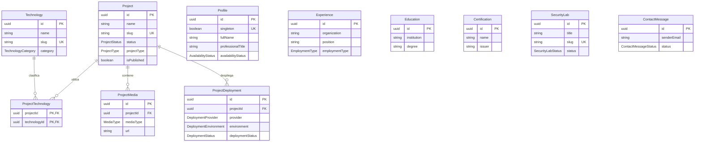

# Modelo de datos

## Decisiones

- Once modelos. Todos los identificadores de entidad usan PostgreSQL `uuid` con generación UUID desde Prisma. La tabla de unión tiene una clave primaria compuesta por sus dos UUID; no necesita identificador adicional.
- `Profile` permite como máximo un registro. `singleton` tiene `UNIQUE`, `NOT NULL` y un `CHECK (singleton = true)` añadido explícitamente en SQL. No exige que exista un perfil ni inserta uno ficticio.
- Campos profesionales y de proyectos desconocidos son opcionales. `projectType` no tiene valor predeterminado para evitar atribuir un tipo no confirmado.
- Slugs únicos en Technology, Project y SecurityLab. La unicidad distingue mayúsculas; los productores de datos deben normalizar sus slugs a minúsculas.
- Categorías, estados, modalidades laborales y entornos son enums PostgreSQL. TypeScript se clasifica como TOOLS por ser transversal; cada tecnología tiene una categoría primaria.
- Fechas de negocio usan `date`; auditoría y despliegues usan `timestamptz(3)`. `createdAt` tiene valor SQL predeterminado y `updatedAt` lo mantiene Prisma. Escrituras SQL directas deben actualizar `updatedAt` explícitamente.
- Los `CHECK` de intervalos impiden fechas de fin anteriores a inicio. Una experiencia actual no puede tener fecha de fin. Prisma no representa estos CHECK: conservarlos en el historial SQL y revisar futuras migraciones.
- URLs y textos largos usan `text`; nombres, slugs y asuntos tienen límites explícitos. La validación de formato de correo, URL y contenido será responsabilidad de la futura API. No se confunde un límite de almacenamiento con validación de negocio.
- `SecurityLab.toolsUsed` es una lista de nombres. No se asocian laboratorios ni tecnologías a proyectos sin evidencia.
- Experience, Education, Certification y SecurityLab representan contenido del único propietario, sin FK a Profile. Así pueden cargarse antes de completar el perfil. ContactMessage es una bandeja independiente.
- Borrar un Project elimina en cascada sus vínculos, medios y despliegues. Borrar una Technology referenciada está restringido. Todas las FK usan actualización en cascada. No hay relaciones huérfanas.

## Índices

| Índice | Consulta prevista |
| --- | --- |
| Claves únicas de slug | Recuperar el detalle por slug |
| Technology(category, sortOrder) | Catálogo por categoría y orden |
| Project(isPublished, isFeatured, sortOrder) | Listado público y destacados |
| Project(status) | Filtrar proyectos por progreso |
| ProjectTechnology(projectId, technologyId), PK | Tecnologías de un proyecto y evitar duplicados |
| ProjectTechnology(technologyId) | Consulta inversa y comprobación de FK |
| ProjectMedia(projectId, sortOrder) | Galería ordenada |
| ProjectDeployment(projectId, environment, deploymentStatus) | Despliegues por proyecto y entorno |
| Experience(sortOrder, startedAt) | Experiencia ordenada |
| SecurityLab(isPublished, status) | Laboratorios públicos por estado |
| ContactMessage(status, createdAt) | Bandeja de contacto |

No se añaden índices a cada columna: tienen coste de escritura y deben justificarse con las consultas futuras.

## Diagrama entidad-relación

El esquema completo con todos los campos está en `prisma/schema.prisma`. Las entidades independientes se muestran sin relaciones artificiales.

## Prisma y futuras aplicaciones

Prisma 7 utiliza `prisma.config.ts` para la URL de conexión y el comando de seed. El generador `prisma-client` produce TypeScript en `generated/prisma`; el código versionado lo importa desde la fábrica de `packages/database/src/client.ts`.

El adaptador `@prisma/adapter-pg` administra el acceso PostgreSQL. Cada consumidor crea una instancia y la desconecta al finalizar. El backend NestJS reutiliza esta fábrica desde un único PrismaService exportado por PrismaModule, con hooks de inicio y cierre. HealthModule consume ese mismo servicio. Ver `docs/backend.md` para los límites del pool y la operación de la API.

## Migraciones y seed

La migración inicial se genera mediante `prisma migrate diff --from-empty --to-schema prisma/schema.prisma --script` y se complementa con CHECK SQL antes de aplicarla mediante `prisma migrate deploy`. Se conserva `migration_lock.toml`.

Para cambios posteriores usar `npm run db:migrate -- --name descripcion` en desarrollo; revisar y versionar el SQL. Si Prisma solicita resetear una base con datos, detenerse e investigar el historial. No se utiliza `db push` ni reseteos como sustituto de migraciones.

El seed es una transacción atómica y conserva datos existentes. La unicidad del slug evita duplicados; modificar un slug manualmente cambia la identidad natural que usa el seed. No ejecutar seeds simultáneos durante la preparación inicial.
