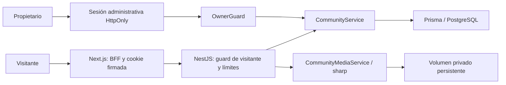

# Portfolio Community — implementación y entrega

Fecha: 15 de noviembre de 2026. Trabajo local; sin commits, push ni despliegue.

## Inspección y alcance

El repositorio es un monorepo npm: Next.js 16 / React 19 / TypeScript en `apps/web`, NestJS 12 en `apps/api`, Prisma 7 y PostgreSQL, con cliente compartido en `packages/database`. La inspección no encontró autenticación pública ni panel administrativo. Se reutilizan configuración, validaciones, filtros de excepciones, límites de solicitudes, API de visitas, almacenamiento de comentarios y Me gusta, y el cliente Prisma existentes.

La comunidad se integra únicamente en la landing. Se retira la barra flotante de interacciones; las demás secciones conservan su implementación. Los comentarios nuevos pertenecen exclusivamente al portafolio general. Los datos anteriores permanecen y su campo histórico `topic` no se destruye, aunque el editor ya no permite seleccionar proyectos.

## Arquitectura



El navegador nunca recibe la clave del propietario ni el secreto de firma. El BFF firma la identidad anónima para cada solicitud a la API. Las respuestas públicas contienen únicamente los campos necesarios para presentar la conversación. Identificadores internos de participantes, claves de almacenamiento y reportes no se entregan al público.

## Modelos y migraciones

La migración aditiva `20261115020000_advanced_community` amplía:

- `PortfolioVisitor`: bloqueo del participante; relaciones con interacciones y medios.
- `PortfolioComment`: categoría opcional, padre/respuestas, estados `APPROVED/PENDING/HIDDEN/DELETED`, rol `VISITOR/OWNER`, fijado, scope y proyecto futuro opcional.
- `PortfolioLike`: conserva las preferencias existentes y añade integridad referencial.

Añade `CommentAttachment`, `CommunityReaction`, `CommentReport` y `ModerationAction`. Incluye claves foráneas, índices de listado, restricciones de rol/estado, límites de tamaño y unicidad de reacción por participante y destino. Los visitantes faltantes de registros anteriores se incorporan antes de aplicar las relaciones. No se borran visitas, Me gusta ni comentarios existentes.

Las reacciones del portafolio usan destino `portfolio`; las de comentarios usan su UUID. Una reacción por navegador y destino puede cambiarse o retirarse. Los reportes se deduplican por participante y comentario. Las respuestas se agrupan bajo el comentario raíz y se paginan. Ocultar o eliminar un comentario raíz también impide la exposición pública de sus respuestas e imágenes.

La eliminación administrativa es recuperable: estado `DELETED`, sin destruir el historial. Aprobar permite recuperar el comentario. Las acciones de aprobar, ocultar, eliminar, fijar, responder, resolver reportes y bloquear/desbloquear se registran en auditoría.

## Endpoints

### Navegador → Next.js

| Método / ruta | Uso |
| --- | --- |
| POST `/api/visitors` | Registrar navegador y obtener total, nuevos de hoy y actividad reciente |
| GET `/api/community?sort=recent&page=1` | Interacciones y comentarios raíz |
| GET `/api/community?replies=UUID&page=1` | Respuestas paginadas |
| POST `/api/community` | Acciones `like`, `react`, `comment`, `report` |
| POST `/api/community/uploads` | Validar y preparar una imagen |
| DELETE `/api/community/uploads?id=UUID` | Retirar un adjunto propio todavía sin publicar |
| GET `/api/community/media/UUID` | Imagen procesada, con permisos comprobados de nuevo |
| GET/POST/DELETE `/api/community-admin/session` | Estado, acceso y cierre de sesión del propietario |
| GET/POST `/api/community-admin` | Listado, estadísticas, moderación y limpieza de adjuntos caducados |

### Next.js → NestJS (`/api/v1`)

| Método / ruta | Protección |
| --- | --- |
| POST `/visitors` | Identidad firmada |
| GET `/community` | Identidad firmada; sort recent/popular/oldest y página |
| GET `/community/comments/:id/replies` | Identidad firmada y comentario público accesible |
| POST `/community/likes` | Identidad firmada y participante no bloqueado |
| POST `/community/reactions` | Identidad firmada y destino validado |
| POST `/community/comments` | Validación, límites y espera entre publicaciones |
| POST `/community/reports` | Validación y deduplicación |
| POST `/community/uploads` | Identidad, límites multipart y transformación de imagen |
| DELETE `/community/uploads/:id` | Propiedad del adjunto y estado sin publicar |
| GET `/community/media/:id` | Publicación aprobada o permisos de propietario/carga pendiente propia |
| GET/POST `/community-admin` | `OwnerGuard`, credencial servidor a servidor |
| POST `/community-admin/purge-staged` | Propietario; adjuntos sin publicar de más de 24 horas |

## Interfaz

- `CommunitySection`: encabezado, métricas horizontales, compartir mediante Web Share o copiar enlace, orden y paginación. No hay cifras ni testimonios de ejemplo.
- `CommunityComposer`: avatar, nombre público, categoría opcional, texto dinámico, emojis, contador de 2000 caracteres y estados de publicación. Soporta input de archivos, Ctrl+V y arrastrar/soltar.
- Adjuntos: hasta tres imágenes con vista previa, validación en curso, retirada y errores individuales. El borrador permanece si falla una solicitud. Se bloquea la edición durante el envío para no perder texto agregado mientras se publica.
- `CommunityThread`: texto plano, insignia de autor emitida por backend, categoría, fijado, reacciones, respuestas y reportes.
- Visor: diálogo nativo con Escape, cierre, imagen anterior/siguiente y foco administrado por el navegador.
- `CommunityAdmin`: `/admin/community`, acceso privado, filtros, estadísticas, acciones, respuestas del autor e historial.
- Diseño blanco, azul marino y azul corporativo; tamaños moderados, skeletons y animaciones discretas que respetan `prefers-reduced-motion`.

## Seguridad y privacidad

- UUID anónimo en cookie firmada HMAC, HttpOnly y SameSite. El token entre BFF y API dura cinco minutos; la cookie de visitante dura un año. Sin IP ni perfil personal almacenados. Los recuentos representan navegadores, no personas verificadas; borrar cookies o usar otro navegador puede sumar otra visita.
- La conversión de antiguas cookies UUID sin firma requiere una identidad nueva. Los registros previos permanecen; el contador no reconstruye personas históricas.
- Sesión del propietario firmada, HttpOnly, SameSite Strict, ocho horas. Sin cuenta de administrador predeterminada ni clave en JavaScript público. El acceso queda deshabilitado si falta la credencial. Secretos mínimos de 48 caracteres y generador criptográfico local.
- Cookie Secure para HTTPS y producción pública. La excepción HTTP se limita a loopback para comprobar el build local.
- Sin secreto de firma en producción, las rutas de comunidad fallan de forma cerrada. En desarrollo existe un valor exclusivo de pruebas locales; el configurador genera valores aleatorios y no imprime secretos.
- CSRF: los cambios del BFF requieren Origin idéntico y rechazan solicitudes cross-site. La API requiere firma del BFF, incluso si se invoca directamente. El administrador necesita además su credencial exclusiva.
- El visitante no puede enviar rol, insignia, scope o proyecto. Nombre libre no equivale a identidad verificada; solo la respuesta administrativa obtiene rol OWNER.
- Prisma y consultas parametrizadas; texto presentado por React sin HTML ejecutable. URLs de adjuntos generadas por el servidor, sin enlaces de imagen arbitrarios.
- Límites por identidad firmada, sin confiar en X-Forwarded-For. Cinco publicaciones por minuto, intervalo adicional de 30 segundos; límites de reportes, subidas y cuota de adjuntos preparados. Inicio de sesión limitado por proceso.
- PNG/JPEG/WebP hasta 5 MB, MIME coherente con decodificación real; se rechazan formatos falsificados, truncados y animados, y más de 16 millones de píxeles. `sharp` se reutiliza como dependencia directa explícita de la API.
- Rotación de orientación, reducción a un máximo de 2560 px y conversión a WebP sin EXIF/GPS/XMP. Los originales y nombres de archivo se descartan; la base contiene metadatos y clave, nunca Base64.
- Archivos fuera de `public/`, nombres aleatorios y permisos de lectura comprobados en cada solicitud; respuesta WebP con nosniff y sin caché pública. Eliminar adjuntos preparados y limpiarlos exige que sigan sin publicar, evitando carreras con publicación.
- Reportes y auditoría solo son visibles en administración. Los errores y logs no revelan claves, cuerpos, ubicaciones de archivos ni detalles de conexión.

## Configuración

Desarrollo:

```powershell
npm run community:configure
npm run db:generate
npm run db:deploy
npm run api:dev
npm run web:dev
```

El configurador agrega únicamente secretos faltantes a `.env` y `apps/web/.env.local`, ambos ignorados por Git. Si existen valores diferentes, se detiene sin sobrescribirlos. La credencial para entrar a `/admin/community` es el valor privado `COMMUNITY_ADMIN_TOKEN`; no se incluye en el informe ni se imprime en herramientas.

| Variable | Ubicación / propósito |
| --- | --- |
| `COMMUNITY_SIGNING_SECRET` | API y Next.js, mismo valor, al menos 48 caracteres |
| `COMMUNITY_ADMIN_TOKEN` | API y Next.js, mismo valor aleatorio; sin él no hay administración |
| `COMMUNITY_UPLOAD_DIR` | API, ruta absoluta a volumen privado persistente |
| `COMMUNITY_REQUIRE_APPROVAL` | API, `true` activa aprobación previa; `false` publica con posibilidad de moderación |
| `PORTFOLIO_API_URL` | Next.js, origen interno de NestJS |
| `DATABASE_URL` | API y herramientas Prisma, PostgreSQL real |

Producción pendiente: aplicar las migraciones sobre la base del entorno correcto, proveer secretos mediante el gestor del alojamiento, HTTPS, volumen privado persistente y respaldos de base/medios. Programar limpieza de adjuntos sin publicar; el panel ya permite ejecutarla. Para varias instancias, compartir el volumen o sustituir la capa de archivos por object storage, y aplicar rate limiting compartido en la plataforma. La identidad anónima es proporcional al alcance actual: no puede impedir que un abusador cambie de navegador; para mayor exposición conviene identidad autenticada y controles de abuso en el borde. Proteger administración con acceso de plataforma/SSO si se incorpora posteriormente.

La base original se mantuvo sin modificar durante la verificación. Docker no estuvo disponible; las migraciones y pruebas usaron PostgreSQL 18 nativo en una base `community_verify`, con esquemas temporales y comprobación de integridad de las tablas fuera de cada esquema. No se cargaron datos ficticios en producción.

## Verificación

- `npm run lint`: aprobado.
- `npm run typecheck`: aprobado.
- `npm run test:unit`: 16 pruebas aprobadas.
- `npm run web:test`: 11 pruebas aprobadas.
- `npm run community:test:isolated`: 32 pruebas de integración aprobadas con PostgreSQL real. Incluyen respuestas, uploads válidos/engañosos/excesivos, eliminación EXIF, propiedad de adjuntos, rol de autor, duplicados concurrentes, reportes, estados, bloqueo, paginación/orden, rate limiting y persistencia al reiniciar API.
- `npm run api:build`: aprobado.
- `npm run web:build`: Turbopack falló por su proceso de CSS en este entorno; `npm run build --workspace @portfolio/web -- --webpack` compila correctamente usando Webpack incluido en Next.js.
- La prueba de aislamiento detectó una consulta de visitas sin esquema explícito. Se reemplazó por el modelo Prisma correspondiente. La ejecución final verifica que las tablas externas a los esquemas de prueba no cambian.

- `npm run web:test:e2e`: 10 comprobaciones HTTP aprobadas, incluidas las rutas privadas, CSRF y origen local real.
- Revisión en navegador a 390 px y escritorio: publicación real en PostgreSQL aislado, Me gusta persistente, contador de caracteres, preview/subida de imagen y visor con Escape comprobados. El contenido HTML de prueba aparece como texto, sin ejecución. No se observó desbordamiento horizontal a 390 px.
- Evidencia de la instancia de pruebas: `docs/images/community-desktop.jpg` (contiene mensajes marcados como prueba aislada, nunca publicados en producción).
- El origen de las escrituras se compara con el Host real de la solicitud: la revisión detectó que Next normaliza internamente localhost/127.0.0.1. Se corrigió sin aceptar orígenes externos y se añadió una prueba de regresión.

Total automatizado: 69 pruebas aprobadas (16 unitarias de API, 11 de frontend, 32 de integración PostgreSQL y 10 HTTP de Next.js).

## Archivos

| Grupo | Archivos principales |
| --- | --- |
| Datos | `prisma/schema.prisma`, `prisma/migrations/20261115020000_advanced_community/migration.sql` |
| Contratos y firmas | `packages/community/src/contracts.ts`, `packages/community/src/identity.ts` |
| API | `apps/api/src/community/community.module.ts`, `community.dto.ts`, `community.service.ts`, `community-auth.ts`, `community-media.service.ts` |
| Integración API | `apps/api/src/app.module.ts`, `config/environment.ts`, `visitors/visitors.module.ts`, `apps/api/package.json` |
| BFF público | `apps/web/app/api/community/route.ts`, `uploads/route.ts`, `media/[id]/route.ts`, `apps/web/app/api/visitors/route.ts` |
| BFF privado | `apps/web/app/api/community-admin/route.ts`, `session/route.ts`, `apps/web/lib/community-admin-server.ts` |
| Estado y servidor | `apps/web/lib/community-client.ts`, `apps/web/lib/community-server.ts` |
| Interfaz | `apps/web/components/community-section.tsx`, `community-section.module.css`, `community-composer.tsx`, `community-thread.tsx`, `community-reactions.tsx` |
| Administración | `apps/web/app/admin/community/page.tsx`, `apps/web/components/community-admin.tsx`, `community-admin.module.css` |
| Retirada de barra | `apps/web/app/layout.tsx`; eliminados `visitor-rail.tsx` y `visitor-rail.module.css` |
| Pruebas | `apps/api/test/community.integration.test.ts`, `content.unit.test.ts`, `content.integration.test.ts`, `isolated-database.ts`, `apps/web/test/contracts.test.ts`, `apps/web/test/e2e/http.spec.ts` |
| Herramientas | `scripts/configure-community.mjs`, `community-test-db.mjs`, `community-preview.mjs` |
| Configuración | `.env.example`, `apps/web/.env.example`, `.gitignore`, `package.json`, `package-lock.json` |

## Extensión posterior a proyectos

El modelo ya contempla `scope` y `projectId`, pero las rutas actuales fijan `portfolio` en el servidor y no aceptan proyectos del cliente. Una extensión puede añadir rutas por slug publicado, resolver su UUID desde `Project`, reutilizar comentarios, adjuntos y moderación, y ampliar los destinos permitidos de reacciones mediante una nueva migración. Mantener la validación de publicación y permisos en backend; no reutilizar directamente un projectId enviado por el navegador.


## Ajuste posterior solicitado: tarjetas de portafolio

Las tarjetas se redujeron a captura, nombre, stack compacto y etiqueta de tipo (Personal, Colaborativo, Universidad o Cliente). Se eliminan las descripciones, fechas y tablas de contexto de su presentación; la información editorial se conserva en el archivo de datos. GitHub y sitio quedan como iconos discretos. El reverso usa `VeltrixLogo`, compartido con la navbar, con su mismo recurso y composición, en lugar del monograma grande y la marca LinkedIn anterior. Tres por fila en escritorio. FlyMaster incorpora una captura real de su portada pública en `apps/web/public/images/projects/flymaster-preview.jpg`.


Verificación adicional del BFF: acceso del propietario, publicación de comentario y respuesta administrativa devolvieron HTTP 200 desde Next.js; la consulta posterior confirmó el rol OWNER asignado por backend. La sesión se cerró al finalizar. La ayuda `community-preview.mjs` espera readiness de la API antes de servir la vista y acepta `stop` por stdin para cerrar servidores y el esquema temporal.

La última referencia visual se adaptó a las cartas: marco de portátil CSS para capturas reales, curva azul, bordes redondeados y badges/tecnologías en pastillas; se mantiene el contenido compacto. La navbar y el reverso comparten exactamente `VeltrixLogo`. Evidencia de tamaño previo al acabado: cartas de 234–279 px en escritorio, frente a las fichas extensas anteriores.


Resultado visual final: `docs/images/portfolio-reference-style.jpg`. Se verificaron tres cartas por fila en escritorio, giro con el logo compartido de la navbar y ausencia de desbordamiento horizontal a 390 px. Las cartas finales usan `apps/web/components/public-work.tsx`, `public-work.module.css`, `project-flip-card.tsx` y el componente compartido nuevo `veltrix-logo.tsx`; `shell.tsx` conserva el mismo logo visual al reutilizarlo.


## Ajuste visual del 16 de noviembre de 2026

Por nueva indicación del propietario se restaura el patrón de la referencia: tres círculos flotantes a la izquierda para visitas, Me gusta y comentarios, con azules de Veltrix (adaptados a una fila inferior en móvil). Se retira el resumen horizontal y se presenta un panel de comentarios oscuro de ancho completo, con logo de la navbar, título “Lo que dicen de mí”, selector de avatares visible, editor y comentarios debajo. Se mantienen las funciones existentes y los datos reales. Esta indicación posterior reemplaza el requisito visual anterior de retirar la barra lateral; la arquitectura y seguridad del módulo no cambian.
